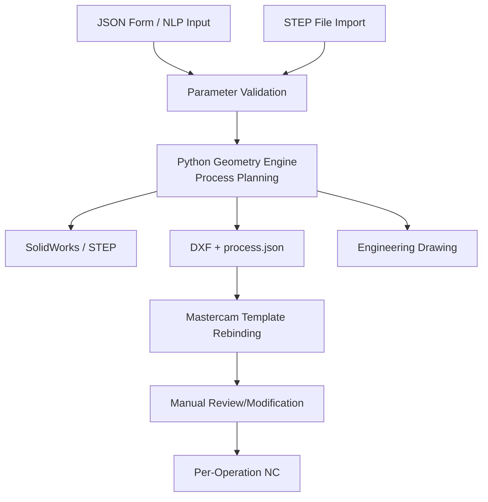
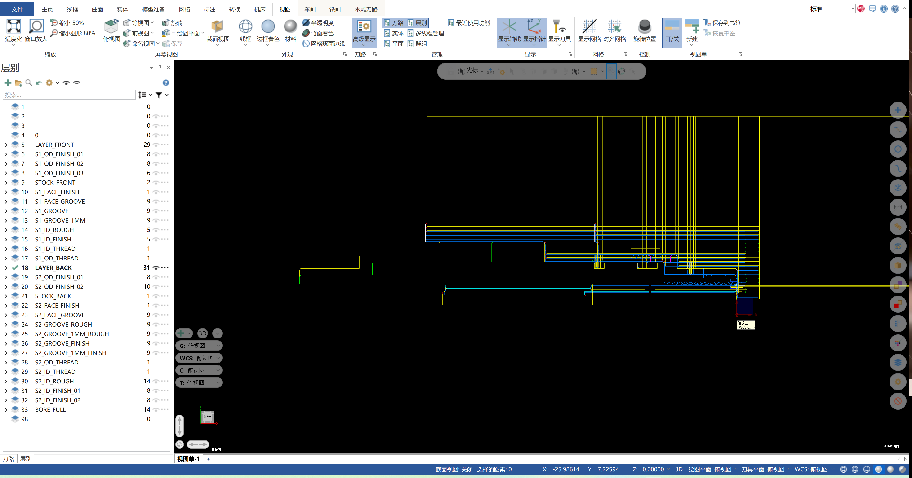
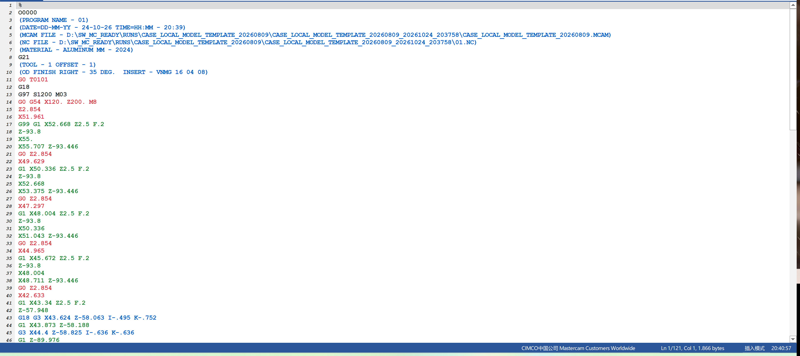
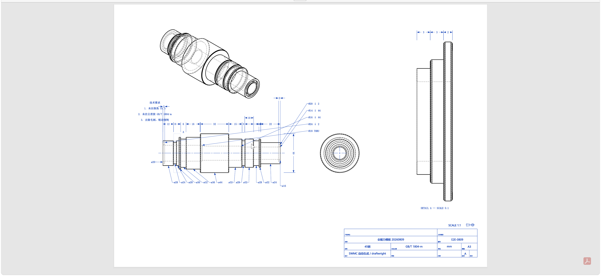

# SW→MC Lathe Closed Loop | 2-Axis CNC Lathe Autoprogramming Prototype

**Language / 语言:** [简体中文](README.md) | [English](README.en.md)

> [Watch the full demo on Bilibili](https://www.bilibili.com/video/BV1mSHg6NERB/)
> This project is a personal learning record of exploring AI-assisted CAD/CAM automation.
> The author received First Prize in the Jiangsu Provincial Vocational College Skills Competition ("现代加工技术" event).
> Contact: [2014170845@qq.com](mailto:2014170845@qq.com)

Input a structured parameter JSON, output a machinable rotational part: SolidWorks model, layered DXF, Mastercam toolpaths, per-operation NC files, and 2D engineering drawings.

Designed for 2-axis lathe machining of stepped shafts and bushings. Uses a 20-operation master template with part-specific filtering, cloning, chain binding, and per-operation postprocessing. Local offline, rule-driven.

---

## Table of Contents

- [System Flow](#system-flow)
- [Technical Architecture](#technical-architecture)
- [Core Technologies](#core-technologies)
- [Limitations & Boundaries](#limitations--boundaries)
- [Documentation](#documentation)

---

## System Flow

**Two Input Paths**:
- **Web Form / NLP** → JSON → Full artifacts (DXF + STEP + Drawing + NC)
- **STEP Import** → JSON → Drawing + NC (no STEP regeneration)

**Core Branches**:
- **MC Path**: DXF + process.json → Mastercam template rebinding → Manual review → NC
- **Drawing**: STEP → draftwright → PDF/DXF (independent, no MC dependency)

**Time** (medium-complexity part: stepped shaft + bore + threads):
- JSON → DXF + process package + STEP: ~1 min
- Mastercam handoff → toolpath binding: ~1 min
- Manual review → NC programs: ~30s
- Drawing generation (independent): ~30s

---

## Technical Architecture

### Tech Stack

| Layer | Technology | Purpose |
|---|---|---|
| **Geometry Engine** | Python 3.14 + OpenCASCADE | Profile solving, R-C-R chamfer/fillet, bore layering, flip-dual planning |
| **Auto Modeling** | C# + SolidWorks Interop | Sketch generation + `FeatureRevolve2` rotation, auto-output SLDPRT & STEP |
| **Profile Exchange** | DXF (custom writer) | Semantic layers by machining intent (`S1_OD_ROUGH` / `S1_ID_FINISH_01` ...), each layer forms a connectable chain |
| **CAM Core** | Mastercam 2026 + C++ C-Hook | Template operation filtering, chain binding, NCI regeneration, per-operation postprocessing |
| **Bridge Layer** | C# NetHook 3.0 | SolidWorks ↔ Mastercam file handoff, request queue, operation tree reordering |
| **Engineering Drawing** | draftwright 0.4.35 (3rd-party, AGPL-3.0) | Read STEP, output PDF/DXF, standalone Python 3.12 environment |
| **UI** | Python HTTP server + static pages | Form input, STEP import, one-click handoff, trigger postprocessing |

**Code Scale**: Python ~22.5k lines + C++ ~8.3k lines + C# ~5.8k lines

---

## Core Technologies

### 1. Semantic Layers: Intent-Based Organization

DXF is not just a pile of lines and arcs, but **organized by machining intent**:

| Layer Name | Meaning | Binds to Operation |
|---|---|---|
| `S1_OD_ROUGH` | Setup-1 OD roughing profile | OD roughing toolpath |
| `S1_OD_FINISH_01` | Setup-1 OD finish span 1 | OD finish toolpath 1 |
| `S1_ID_FINISH_02` | Setup-1 ID finish layer 2 | ID finish toolpath 2 |
| `S1_THREAD_EXT_M10` | Setup-1 external thread M10×1.5 | External thread toolpath |
| `BORE_FULL` | Completed bore full view (reference) | Not bound, view-only |

**Key Points**:
- Each layer's line segments **connect end-to-end**, formable into one chain
- Binding validates by layer name + minimum entity count (e.g., `S1_OD_ROUGH` needs at least 6 lines)
- DXF layer segments must precisely connect; break or sub-millimeter gap causes Mastercam to reject chaining

---

### 2. Cloning & Pruning Mechanism

**Master Template** = 20-operation full set (roughing, finishing, threading, grooving, face grooving...), one `.mcam` file.

**Contract** = Part-specific operation subset (JSON) with SHA-256 hash verification.

**Workflow**:
- Bridge layer reads contract, **clones** required operations from master template (e.g., `S1_ID_FINISH` needs 3 layers, clones `_01` / `_02` / `_03`)
- Native layer binds chains per contract, regenerates NCI, postprocesses one by one
- Excess resident operations (template has 20, part uses 12) are **auto-deleted after postprocessing**
- **Master template file never changes**, only the in-memory Mastercam session copy is modified

**Why**: The template was manually tuned and verified in Mastercam through parameter adjustment and simulation. Modifying the template = re-verifying all operations. The contract mechanism decouples "verified template" from "which operations this part needs".

---

### 3. Chain Rebinding: Runtime Pairing of Semantic Layers

**DXF semantic layers** (Section 1) generate "intent labels". **Chain rebinding** pairs labels to actual Mastercam geometry.

**Binding Flow**:
1. Bridge layer reads DXF, imports into Mastercam by layer name (`S1_OD_ROUGH` layer → MC's `S1_OD_ROUGH` level)
2. Native layer iterates operations per contract, calls `BuildChainFromLevelName` to construct native CHAIN
3. Validates chain entity count and direction (e.g., `S1_OD_ROUGH` at least 6 lines, `S1_ID_FINISH_02` at least 4 lines)
4. Calls `AddNamedDriveChainToOperation` to bind chain to operation
5. After validation, calls `NCIMGR_REGEN_ONE` to regenerate that operation's NCI

**Why Two Steps** (semantic layer + rebinding):
- DXF generation is Mastercam-independent, geometry correctness can be independently verified
- Binding only needs layer name match; profile coordinates and segment order can change as long as topology is consistent
- Same DXF set can bind to different templates (12/18/20 operations), only contract differs

---

### 4. Flip-Dual & Auto Bore Direction Flip

**Scenario**: Bores with length-to-diameter ratio exceeding 6:1 cannot be fully bored from one end — must flip and bore from the other end.

**S1 / S2 Coordinate Systems**:
- S1 (Setup 1): Origin at right end face, X-axis negative towards left
- S2 (Setup 2): Origin at left end face, X-axis positive towards right (part flipped 180°)

**Key Rules**:
- S2 DXF layers are **end-for-end mirrored** (`x → x_min + x_max - x`)
- Binding recognizes layer name only, not coordinates (`S2_OD_FINISH` binds to `S2_OD_FINISH` layer regardless of drawn location)

**Auto Bore Direction Flip**: For the same stepped bore, diameter decreasing (Ø18 → Ø14) can be bored in one pass, but increasing (Ø14 → Ø18) causes the boring bar to jam. System first judges from input view, if infeasible, **flips input view** (reverses `bore.segments` order) and judges again. Criteria: bore diameter must decrease from large to small (boring bar constraint), OD has no monotonicity requirement (turning tool can radially retract), any segment exceeding 6:1 aspect ratio auto-triggers flip.

---

### 5. SolidWorks Auto Modeling

**Sketch Generation**: Calculate profile points from parameter JSON → Generate C# code → Call `ISketchManager.CreateLine` / `CreateArc` to draw segment by segment → `FeatureRevolve2` rotation forming.

**Key Points**:
- Arc direction parameter (`Direction: ±1`) determines success, reversed direction returns NULL
- R-C-R (fillet-chamfer-fillet) segments precisely described with `("arc", cx, cy, r, start_angle, end_angle)`
- Auto-outputs SLDPRT & STEP, but **requires manual inspection** (sketch may be under-constrained, chamfer direction needs verification)

---

## Process Images

The three images follow the order `Mastercam levels → NC toolpath → engineering drawing`, matching the semantic-chain, postprocessing, and drawing stages of the project.

### 1. Mastercam semantic layers

The Level Manager on the right shows `S1_*` / `S2_*` groups for roughing, finishing, bores, grooves, and threads. The graphics on the left show the same DXF after import and layer separation.

### 2. NC toolpath

The postprocessor output as `.NC` text, showing G21 metric mode, G18 turning plane, tool number, spindle speed, feed, and circular interpolation.

### 3. Engineering drawing

The engineering drawing is generated from STEP geometry independently of the Mastercam path. Front view, end view, isometric view, dimensions, and title block all come from the same STEP data.

> Automatic generation still requires manual review of layout, annotation clearance, and process notes; a generated sheet is not a released drawing.

---

## Limitations & Boundaries

### Only One Part Family

The master template is a **20-operation turning family version**. Switching to milling or turn-mill requires remaking the template and rewriting recognition rules — this is a structural issue, not a configuration issue.

### Binding Relationships Are Hardcoded

Operation ↔ layer name ↔ chain level ↔ minimum entity count is written in contract JSON. If the template changes, the contract must sync — one missed entry causes binding failure.

### Drawing Is Third-Party Library

`draftwright` recognizes a hole as "main hole + counterbore", **losing middle layers for 3+ layer bores**, requiring re-reading actual layers from STEP and patching callouts (`patch_stepped_bore_callouts`). Callout collision avoidance is itself a hard problem — current layout is crowded and unvalidated.

### Parameters Are Common Source, Each Stage Still Needs Validation

- **Model**: SolidWorks auto-generated, but requires manual inspection (sketch under-constrained, chamfer direction)
- **Profile**: Computed from parameters, generated in parallel with model (not extracted from STEP)
- **Drawing**: Read from STEP, not directly using profile data

All three paths share input parameters, but each stage generates per purpose — **cannot claim "fully common source" based on parameter consistency alone**.

### No Collision Checking, No Machining Verification

- ❌ No collision detection
- ❌ No physical cutting verification
- ⚠️ NC programs only passed text structure scanning (M8/M9, coordinate range, tool numbers)

**On where the toolpaths come from:** these are not hand-written or spliced G-code blocks. The toolpaths are computed by the Mastercam kernel, and the NC output is produced by Mastercam post processors. Toolpath planning, feed calculation, and postprocessing all come from a commercial CAM system that has been used in industry for a long time, not from algorithms written for this project.

**However, the author has not verified this on a real machine**, so this is a judgment about the reliability of the source, not a claim that the result has been validated. The author's personal assessment of usability is reasonably high; actual operation still requires independent confirmation by the operator.

---

## Usage & Responsibility

> **This system has no collision detection and no physical cutting verification.**  
> Toolpaths are computed by the Mastercam kernel and NC output is produced by Mastercam post processors, but this was not verified on a real machine.  
> NC programs only passed text structure scanning, no guarantee of producing qualified parts.  
> The operator is responsible for machine, fixture, tools, feed parameters, and physical test procedure.

---

## Documentation

- [Project Overview](docs/PROJECT_OVERVIEW.md) — Positioning, why it is layered this way, phase closeout
- [Architecture Notes](docs/ARCHITECTURE.md) — Pipeline layering, semantic layers, template isolation, operation contracts
- [Limitations & Verification Boundaries](docs/LIMITATIONS.md) — No collision checking, no physical cutting, toolpath source note, SW/STEP verification gaps, drawing boundaries

---

## License

> This repository is a project record, source code not included.  
> `draftwright` uses AGPL-3.0 license (3rd-party library), current usage (local-only execution, no distribution) does not trigger its obligations.

---

  Built with SolidWorks · Mastercam · OpenCASCADE · Python · C++ · C#

