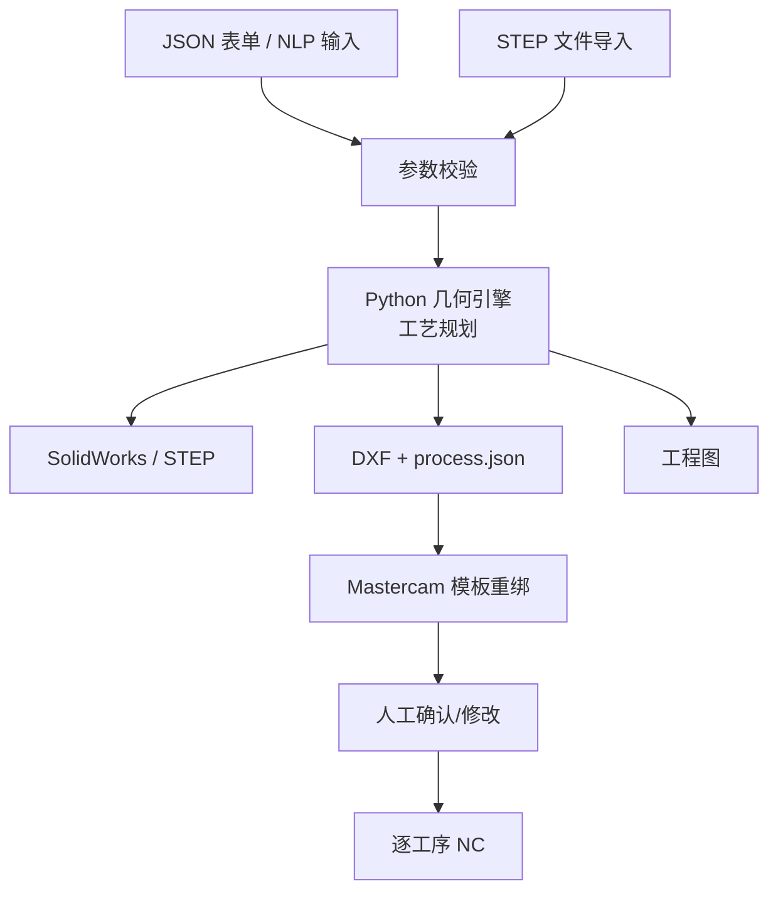

# SW→MC 车削闭环｜二轴车削自动编程原型

**语言 / Language:** [简体中文](README.md) | [English](README.en.md)

> [在 B 站观看完整演示](https://www.bilibili.com/video/BV1mSHg6NERB/)
> 本项目为个人学习记录，记录 AI 辅助下探索 CAD/CAM 自动化的过程。
> 项目作者获得江苏省职业院校技能大赛“现代加工技术”一等奖。
> 联系邮箱：[2014170845@qq.com](mailto:2014170845@qq.com)

输入一份结构化参数 JSON，输出可加工的回转体零件：SolidWorks 模型、分层 DXF、Mastercam 刀路、逐工序 NC、二维工程图。

面向二轴车床的阶梯轴与轴套，用一套 20 工序母模板按零件裁剪、克隆、绑链，再逐条后处理。本地离线，规则驱动。

---

## 目录

- [系统流程](#系统流程)
- [技术架构](#技术架构)
- [核心技术](#核心技术)
- [局限与边界](#局限与边界)
- [文档](#文档)

---

## 系统流程

**两条输入链路**：
- **Web 表单 / NLP** → JSON → 全套产物（DXF + STEP + 工程图 + NC）
- **STEP 导入** → JSON → 工程图 + NC（不再生成 STEP）

**核心分支**：
- **MC 链路**：DXF + process.json → Mastercam 模板重绑 → 人工确认 → NC
- **工程图**：STEP → draftwright → PDF/DXF（独立，不依赖 MC）

**时间**（中等复杂度零件：阶梯轴 + 内孔 + 螺纹）：
- JSON → DXF + 工艺包 + STEP：~1 分钟
- Mastercam 交接 → 刀路绑定：~1 分钟
- 人工确认 → NC 程序：~30 秒
- 工程图生成（独立）：~30 秒

---

## 技术架构

### 技术栈

| 层 | 技术 | 作用 |
|---|---|---|
| **几何引擎** | Python 3.14 + OpenCASCADE | 轮廓求解、R-C-R 倒角倒圆、内孔分层、翻转双头规划 |
| **自动建模** | C# + SolidWorks Interop | 草图生成 + `FeatureRevolve2` 旋转，自动输出 SLDPRT 与 STEP |
| **轮廓交换** | DXF（自写 writer） | 按加工意图分语义层（`S1_OD_ROUGH` / `S1_ID_FINISH_01` ...），每层一条可串连的链 |
| **CAM 核心** | Mastercam 2026 + C++ C-Hook | 模板操作裁剪、链绑定、NCI 再生、逐工序后处理 |
| **桥接层** | C# NetHook 3.0 | SolidWorks ↔ Mastercam 文件交接、请求队列、操作树重排 |
| **工程图** | draftwright 0.4.35（第三方，AGPL-3.0） | 读 STEP 输出 PDF/DXF，独立 Python 3.12 环境 |
| **UI** | Python HTTP 服务 + 静态页 | 表单输入、STEP 导入、一键交接、触发后处理 |

**代码规模**：Python ~22.5k 行 + C++ ~8.3k 行 + C# ~5.8k 行

---

## 核心技术

### 1. 语义图层：按意图分层

DXF 不是一堆线和弧，而是**按加工意图分语义层**：

| 图层名 | 含义 | 绑定到的操作 |
|---|---|---|
| `S1_OD_ROUGH` | 第一头外圆粗车轮廓 | 外圆粗车刀路 |
| `S1_OD_FINISH_01` | 第一头外圆精修第 1 段 | 外圆精车第 1 条 |
| `S1_ID_FINISH_02` | 第一头内孔精修第 2 层 | 内孔精车第 2 条 |
| `S1_THREAD_EXT_M10` | 第一头外螺纹 M10×1.5 | 外螺纹刀路 |
| `BORE_FULL` | 完工内孔全貌（参考层） | 不绑定，仅供查看 |

**关键点**：
- 每层的线段**首尾相接**，可以串成一条链
- 绑定时按层名 + 最小图元数校验（比如 `S1_OD_ROUGH` 至少 6 条线）
- DXF 图层的线段必须精确相接，断链或微小间隙（亚毫米级）Mastercam 都会拒绝串连

---

### 2. 克隆与修剪机制

**母模板** = 20 工序全集（粗车、精车、螺纹、开槽、端面槽...），一个 `.mcam` 文件。

**合同** = 按零件筛选出的工序子集（JSON），带 SHA-256 哈希校验。

**工作流**：
- 桥接层读取合同，从母模板**克隆**需要的操作（比如 `S1_ID_FINISH` 需要 3 层，克隆出 `_01` / `_02` / `_03`）
- 原生层按合同绑定链、再生 NCI、逐条后处理
- 多余的驻留操作（模板有 20 条，零件只用 12 条）后处理后**自动删除 NC**
- **母模板文件始终不动**，改的是 Mastercam 内存中的副本

**为什么这么做**：模板是通过人工在 Mastercam 里调参、仿真验证过的。改模板 = 重新验证全部工序。合同机制让"验证过的模板"和"当前零件需要哪些工序"解耦。

---

### 3. 链重新绑定：语义层的运行时对接

**DXF 语义层**（第1节）生成的是"意图标签"，**链重新绑定**把标签对接到 Mastercam 实际几何。

**绑定流程**：
1. 桥接层读取 DXF，按层名导入 Mastercam（`S1_OD_ROUGH` 层 → MC 的 `S1_OD_ROUGH` 图层）
2. 原生层按合同遍历每个操作，调用 `BuildChainFromLevelName` 构建原生 CHAIN
3. 校验链的图元数与方向（比如 `S1_OD_ROUGH` 至少 6 条线，`S1_ID_FINISH_02` 至少 4 条线）
4. 调用 `AddNamedDriveChainToOperation` 把链绑定到操作
5. 验证通过后调用 `NCIMGR_REGEN_ONE` 再生该操作的 NCI

**为什么分两步**（语义层 + 重新绑定）：
- DXF 生成时不依赖 Mastercam，可以独立验证几何正确性
- 绑定时只需要层名匹配，轮廓坐标、线段顺序都可以改，只要拓扑一致
- 同一套 DXF 可以绑定到不同模板（12/18/20 工序），只需要合同不同

---

### 4. 翻转双头与钻孔方向自动判断

**场景**：长细比超 6:1 的内孔，从一头镗不到底，要翻面从另一头镗。

**S1 / S2 坐标系**：
- S1（第一头）：零点在右端面，X 轴负向向左
- S2（第二头）：零点在左端面，X 轴正向向右（相当于把零件翻转 180°）

**关键规则**：
- S2 的 DXF 图层一律 **end-for-end 镜像**（`x → x_min + x_max - x`）
- 绑定时只认层名，不认坐标（`S2_OD_FINISH` 绑到 `S2_OD_FINISH` 层，无论它画在哪）

**钻孔方向自动判断**：同样的阶梯内孔，口径从大到小（Ø18 → Ø14）可以一刀镗到底，从小到大（Ø14 → Ø18）镗杆会卡住。系统会先按输入视角判断，不行则**翻转输入视角**（把 `bore.segments` 顺序反转）再判断一次。判据：内孔口径必须从大到小（镗杆约束），外圆无单调性要求（车刀可径向让刀），任何一段长细比超过 6:1 自动触发翻转。

---

### 5. SolidWorks 自动建模

**草图生成**：从参数 JSON 计算轮廓点 → 生成 C# 代码 → 调用 `ISketchManager.CreateLine` / `CreateArc` 逐段绘制 → `FeatureRevolve2` 旋转成型。

**关键点**：
- 圆弧方向参数（`Direction: ±1`）决定成败，方向反了返回 NULL
- R-C-R（圆角-倒角-圆角）段用 `("arc", cx, cy, r, start_angle, end_angle)` 精确描述
- 自动输出 SLDPRT 与 STEP，但**需人工打开确认**（草图可能欠约束、倒角方向需校验）

---

## 局限与边界

### 只有一个零件族

母模板是**车削族的 20 工序版本**。换铣削或车铣复合要重做模板，识别规则也要跟着改——这是结构问题，不是配置问题。

### 绑定关系是写死的

工序 ↔ 层名 ↔ 链层级 ↔ 最小图元数，写在合同 JSON 里。模板一改，合同必须同步改，漏一处就绑链失败。

### 图纸是第三方库

`draftwright` 把一个孔认成"主孔 + 沉孔"，**三层以上会丢中间层**，所以要从 STEP 重读真实层再补标注（`patch_stepped_bore_callouts`）。标注避让本身是难题，目前版面拥挤，未验收。

### 参数同源，各环节仍需校验

- **模型**：SolidWorks 自动生成，但需人工打开确认（草图欠约束、倒角方向）
- **轮廓**：从参数计算，与模型平行生成（不是从 STEP 提取）
- **图纸**：从 STEP 读取，不是直接用轮廓数据

三条路的输入参数相同，但各环节按用途生成，**不能仅凭参数一致宣布"完全同源"**。

### 无碰撞检查、无实切验证

- ❌ 无碰撞检查
- ❌ 无实切验证
- ⚠️ NC 仅做过文本结构扫描（M8/M9、坐标范围、刀号）

**关于刀路的来源**：这里的刀路不是手写或拼接的 G 代码。刀轨由 Mastercam 内核计算，NC 由 Mastercam 后处理器输出。也就是说，轨迹规划、进给计算、后处理这三步都来自一套工业上长期使用的商业 CAM 系统，而不是本项目的自研算法。

**但作者没有在真机上验证过**，所以这是一个关于"来源可靠"的判断，不是"已验证可用"的结论。个人评估可用度较高，实际操作仍需由操作者独立确认。

---

## 使用与责任

> **本系统无碰撞检查、无实切验证。**  
> 刀轨由 Mastercam 内核计算、NC 由 Mastercam 后处理器输出，但未在真机上验证。  
> NC 程序仅做过文本结构扫描，不保证可加工出合格零件。  
> 操作员对机床、夹具、刀具、进给参数、物理测试流程负责。

---

## 文档

- [项目总览](docs/PROJECT_OVERVIEW.md) — 项目定位、为什么这样分层、阶段收尾
- [架构说明](docs/ARCHITECTURE.md) — 链路分层、语义图层、模板隔离、操作合同
- [局限与验证边界](docs/LIMITATIONS.md) — 无碰撞无实切、刀路来源说明、SW/STEP 待校验项、图纸边界

---

## 许可证

> 本仓库是项目记录，不含源码。  
> `draftwright` 使用 AGPL-3.0 许可证（第三方库），当前用法（仅本机运行、不分发）不触发其义务。

---

  Built with SolidWorks · Mastercam · OpenCASCADE · Python · C++ · C#

