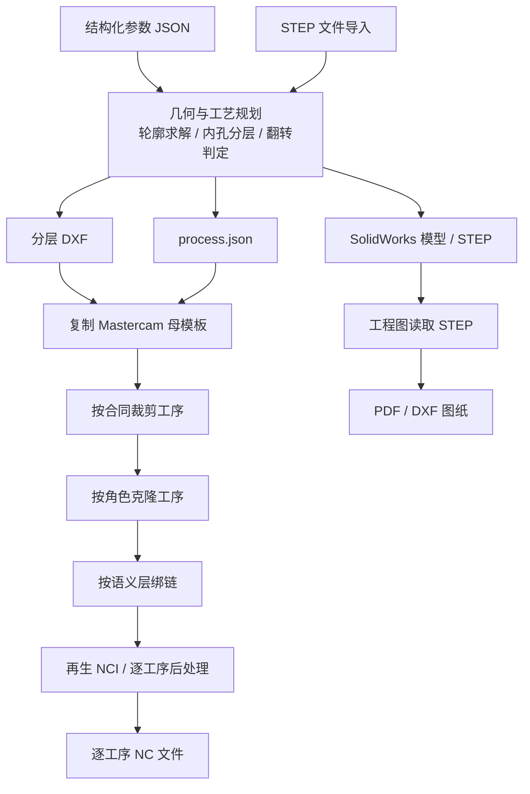
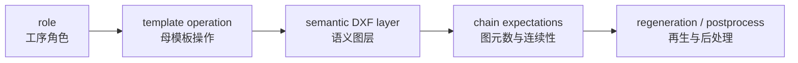

# Architecture Notes

## Pipeline

The four stages are input resolution, planning, exchange, and CAM handoff. The drawing branch reads STEP independently and is not part of the CAM handoff.

## Important Separation

The actual production path is not a single opaque “SolidWorks to NC” call.

- **Design branch:** parameters can generate a SolidWorks revolve model and STEP.
- **CAM branch:** the same input is resolved into profile geometry and process intent, then handed to Mastercam.
- **Drawing branch:** STEP geometry is read by the drawing tool and annotated independently.

The branches share input meaning, but they do not share every generated entity. Each branch needs its own checks.

## Semantic Layers

Examples of layer-level intent:

| Layer | Meaning |
| --- | --- |
| `S1_OD_ROUGH` | Setup-one external roughing profile |
| `S1_OD_FINISH_01` | Setup-one external finish span |
| `S1_ID_FINISH_02` | Setup-one internal finish span |
| `S1_THREAD_EXT_M10` | Setup-one external thread intent |
| `S2_*` | Setup-two geometry and operation intent |
| `BORE_FULL` | Reference geometry, not a machining chain |

The layer name is part of the contract. A chain is accepted only after geometry continuity and expected entity checks pass.

## Template Isolation

The master template is treated as an input artifact. A case copy is created before any case-specific mutation. The public description intentionally omits installation paths, binary plug-ins, and proprietary template files.

This separation matters because a template is not just a file full of geometry. It contains manually tuned operation settings and postprocessing assumptions. A case-specific modification must not become a silent template modification.

## Operation Contracts

An operation contract describes the selected roles for one case. It connects:

The contract is also where unsupported combinations should be rejected. The intended behavior is to stop with an explicit error instead of silently producing a plausible but incomplete process package.

## Output Traceability

Each result should be traceable back to:

- the input parameter file or STEP file;
- the resolved process JSON;
- the generated DXF layers;
- the case-copy Mastercam file;
- the operation-level result;
- the NC output and its structural report.

This is why the private development workspace has separate `inputs`, `process-json`, `exchange`, `mc-files`, `outputs`, and `reports` areas. This public repository records the structure without publishing the local artifacts themselves.

